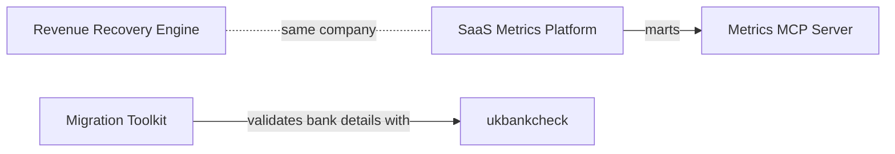

# Hi, I'm Raza 👋

I build data pipelines, automation and AI tooling, with a focus on making them **correct,
re-runnable and safe when things go wrong**.

<!-- Add your LinkedIn link here, e.g.:

-->

## Portfolio

Five connected projects built around one fictional SaaS company: its revenue metrics,
its failed payments, its CRM migration, and an AI assistant that can query it safely.

| Project | What it does | Key skills |
|---|---|---|
| [**SaaS Metrics Platform**](https://github.com/Itsraza099/saas-metrics-platform) | ELT pipeline turning billing data into MRR, ARR, NRR, GRR and cohort retention | dbt · Dagster · Postgres · dimensional modelling · data tests |
| [**Revenue Recovery Engine**](https://github.com/Itsraza099/revenue-recovery-engine) | Recovers failed payments: verified webhooks, LLM-drafted emails, human approval | Stripe · Supabase · n8n · idempotency · structured LLM output |
| [**Migration Toolkit**](https://github.com/Itsraza099/migration-toolkit) | Moves legacy CRM data safely: dry runs, fuzzy de-duplication, reconciliation | Python · data profiling · fuzzy matching · control totals |
| [**Metrics MCP Server**](https://github.com/Itsraza099/metrics-mcp-server) | Lets AI assistants query revenue metrics without database access | MCP · least privilege · audit logging · prompt-injection defence |
| [**ukbankcheck**](https://github.com/Itsraza099/ukbankcheck) | Python library validating UK sort codes and account numbers | Packaging · property-based testing · CI/CD |

## How I build

Every project includes **decision records** explaining what I chose, what I rejected and why,
and a **"break it on purpose"** section showing the safety checks catching real failures
(duplicate events, tampered requests, lost rows, malicious inputs).
